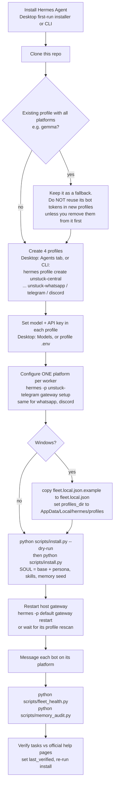

# Install guide (Hermes Desktop + CLI)

Notes
- `install.py` never creates Hermes profiles; create them first.
- One bot token belongs to one profile. The host gateway serves all profiles, so a duplicate token means two pollers.
- Do not enable `gateway.standalone` (Hermes marks it a temporary shim).
- Adding a platform: `python scripts/new_agent.py slack`, `hermes profile create unstuck-slack`,
  `hermes -p unstuck-slack gateway setup`, `python scripts/install.py --only slack`, restart the host gateway.
